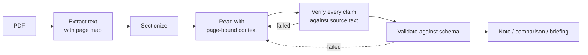

# PaperMentor

**Read papers like a reviewer, not a summarizer.**


[简体中文](README.zh-CN.md) · [Quick start](#quick-start) · [How it works](#how-it-works) · [Validation](#validation)

PaperMentor is an evidence-first reading skill for researchers and students. Give it a text-based PDF and it returns notes you can defend in a group meeting, a literature review, or a rebuttal: every key claim carries a physical page number and a verbatim quote from the source, and every statement is labeled as **paper fact**, **author claim**, **experiment result**, or **model inference**.

Built for the moment someone asks: *"Where exactly does the paper say that?"*

## Why PaperMentor

A general-purpose model can summarize a paper in seconds. It can also invent a page number, round a result, merge the authors' guess with their measurement, and rank two experiments that were never comparable. The summary reads well. The evidence does not survive scrutiny.

PaperMentor is built around a different question: **can this claim be checked?**

| | Typical AI summary | PaperMentor |
|---|---|---|
| Page numbers | optional, sometimes invented | required and verified against the source |
| Quotes | paraphrased | verbatim, matched against extracted text |
| Facts vs. guesses | blended together | four explicit labels, never merged |
| Failed parse | improvises anyway | stops and explains why |
| Cross-paper comparison | ranks the numbers | flags incompatible setups before ranking |

## What you can ask for

| Task | Example request | Output |
|---|---|---|
| Quick scan | "What problem does this paper solve, and what are its limits?" | Four-part scan card |
| Deep read | "Deep-read this paper. Every conclusion needs a page number." | Structured note with evidence index |
| Literature comparison | "Compare the methods and evaluation setups of these five papers." | Unified matrix, consensus, disagreements, open gaps |
| Evidence-bound Q&A | "What batch size did they use for pretraining?" | Answer from the paper only; states when evidence is missing |
| Meeting prep | "Turn these notes into a group-meeting outline and flashcards." | Briefing outline, Q&A cards |

## Quick start

### Requirements

- Python 3.9+
- PyMuPDF 1.24+ (the only runtime dependency)
- Any agent host that supports `SKILL.md` skills

### 1. Install the skill

The repository root *is* the skill. Clone it with the target directory named `paper-mentor` so it matches the `name` field in `SKILL.md`.

User-level install:

```bash
# CodeArts Agent
cd ~/.codeartsdoer/skills
git clone https://github.com/kingdomlight/evidence-paper-mentor-skill.git paper-mentor

# Claude Code
cd ~/.claude/skills
git clone https://github.com/kingdomlight/evidence-paper-mentor-skill.git paper-mentor
```

Project-level install:

```bash
mkdir -p .codeartsdoer/skills
git clone https://github.com/kingdomlight/evidence-paper-mentor-skill.git .codeartsdoer/skills/paper-mentor
```

### 2. Install the parser

```bash
cd paper-mentor
python -m pip install -r scripts/requirements.txt
```

### 3. Verify the environment

```bash
python scripts/paper_tools.py inspect assets/examples/papers/paper01.pdf --output /tmp/inspect.json
```

A `status` of `ok` means you are ready.

## How it works



Two rules separate this pipeline from a chat prompt:

1. **No unsupported claims.** If a claim cannot be matched to extracted source text, it is revised, narrowed, or deleted. The check is never skipped.
2. **No silent degradation.** Scanned PDFs without a text layer, thin extractions, and failed parses produce an explicit stop with the reason — never a confident-looking note.

## The evidence model

Every statement in a note belongs to exactly one class:

| Label | Meaning |
|---|---|
| `paper_fact` | Stated in the paper and traceable to a specific quote |
| `author_claim` | The authors' interpretation, not an experimental result |
| `experiment_result` | A measured number, tied to its dataset and setup |
| `agent_inference` | The model's own reasoning, explicitly not from the paper |

This separation is why the output survives review. A note never presents a guess with the same confidence as a measurement.

## Under the hood

The skill ships deterministic tooling, so parsing and validation do not depend on model judgment:

```bash
python scripts/paper_tools.py inspect    INPUT.pdf --output OUT/inspect.json
python scripts/paper_tools.py extract    INPUT.pdf --output OUT/paper.pages.json
python scripts/paper_tools.py sectionize OUT/paper.pages.json --output OUT/paper.sections.json
python scripts/paper_tools.py context    OUT/paper.sections.json --task read --output OUT/paper.context.json
python scripts/paper_tools.py verify     OUT/note.json --sections OUT/paper.sections.json --output OUT/evidence-report.json
python scripts/paper_tools.py validate   OUT/note.json --schema assets/contracts.json --evidence-report OUT/evidence-report.json --output OUT/validation-report.json
python scripts/paper_tools.py export     OUT/note.json --format markdown --output OUT/reading-note.md
```

Export formats: `markdown`, `json`, `csv`. The `plan` subcommand generates deterministic task plans when the host supports sub-agents.

## Validation

```bash
python scripts/test_skill.py
python scripts/evaluate.py --output-dir /tmp/paper-mentor-eval
```

Offline results from 2026-11-17:

- 39/39 automated tests pass
- 6/6 deep-reading cases pass evidence and schema validation
- 72/72 page-level quotes match the source text

Every bundle in `assets/examples/` is an original synthetic paper built to exercise parsing, evidence tracing, and graceful failure. They validate the pipeline, not performance on real-world papers.

## Repository layout

```text
paper-mentor/
├── SKILL.md
├── README.md
├── README.zh-CN.md
├── scripts/
│   ├── paper_tools.py        parsing, verification, validation, export
│   ├── test_skill.py         39 automated tests
│   ├── evaluate.py           offline evaluation over eight samples
│   └── requirements.txt
├── references/
│   ├── reading-guide.md      single-paper, comparison, Q&A, failure handling
│   ├── quality-and-agents.md evidence rules and sub-agent orchestration
│   └── test-report.md        recorded test and evaluation results
└── assets/
    ├── contracts.json        output schema, defaults, scoring config
    ├── templates.md          scan, deep-read, comparison, briefing templates
    └── examples/             eight synthetic papers and expected outputs
```

## Known limitations

- Text-layer PDFs only. Scanned documents need OCR first, and the skill will say so.
- Quote matching proves presence, not support. Semantic review still requires the model.
- Comparison flags incompatible setups but cannot make them comparable.
- Long papers benefit from host sub-agent support; without it, everything runs serially.

## Contributing

Issues and pull requests are welcome. If you find a claim that slipped past validation, open an issue with the source PDF and the generated note. That is the most valuable bug report this project can receive.

## License

MIT License.