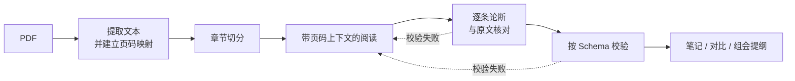

# PaperMentor

**像审稿人一样读论文，而不是像摘要器。**


[English](README.md) · [快速开始](#快速开始) · [工作原理](#工作原理) · [验证结果](#验证结果)

PaperMentor 是一个面向科研人员和学生的**证据型论文阅读 Skill**。给它一篇带文本层的 PDF，它返回的是能在组会、文献综述或答辩现场站得住脚的阅读成果：每条关键结论都带物理页码和原文引用，每句话都标注为**论文事实**、**作者观点**、**实验结果**或**模型推断**。

它专为那个瞬间设计：有人问你——**"论文到底在哪一页这么说？"**

## 为什么需要 PaperMentor

通用大模型几秒钟就能写出一篇论文摘要，也可能顺手编一个页码、抹掉实验条件的差异、把作者的猜测和实测结果混成一句话、再给两个根本不可比的实验排名。摘要读起来很顺，证据经不起追问。

PaperMentor 围绕另一个问题构建：**这条结论能被核查吗？**

| | 普通 AI 摘要 | PaperMentor |
|---|---|---|
| 页码 | 可有可无，有时是编的 | 必须提供，并与原文核对 |
| 引文 | 改写转述 | 原文连续片段，与抽取文本逐字匹配 |
| 事实与猜测 | 混在一起 | 四类标签，永不合并 |
| 解析失败 | 照样编出完整笔记 | 停止输出并说明原因 |
| 多篇对比 | 直接按数值排名 | 先标注实验口径不可比 |

## 你可以让它做什么

| 任务 | 典型请求 | 产出 |
|---|---|---|
| 速读 | "这篇论文解决什么问题，局限是什么？" | 四段式速读卡片 |
| 精读 | "精读这篇，每条结论都要有页码。" | 带证据索引的结构化笔记 |
| 文献对比 | "对比这五篇论文的方法和实验设置。" | 统一维度矩阵、共识、分歧、研究空白 |
| 证据问答 | "预训练用的 batch size 是多少？" | 只依据原文回答，证据不足时明确说明 |
| 组会准备 | "把这些笔记整理成组会提纲和复习卡片。" | 汇报提纲、问答卡片 |

## 快速开始

### 环境要求

- Python 3.9+
- PyMuPDF 1.24+（唯一运行时依赖）
- 支持 `SKILL.md` 形式的 Agent 宿主

### 1. 安装 Skill

仓库根目录就是 Skill 本体。克隆时必须把目标目录命名为 `paper-mentor`，与 `SKILL.md` 中的 `name` 保持一致。

用户级安装（所有项目可用）：

```bash
# 码道 Agent
cd ~/.codeartsdoer/skills
git clone https://github.com/kingdomlight/evidence-paper-mentor-skill.git paper-mentor

# Claude Code
cd ~/.claude/skills
git clone https://github.com/kingdomlight/evidence-paper-mentor-skill.git paper-mentor
```

项目级安装（仅当前项目可用）：

```bash
mkdir -p .codeartsdoer/skills
git clone https://github.com/kingdomlight/evidence-paper-mentor-skill.git .codeartsdoer/skills/paper-mentor
```

### 2. 安装解析依赖

```bash
cd paper-mentor
python -m pip install -r scripts/requirements.txt
```

### 3. 验证环境

```bash
python scripts/paper_tools.py inspect assets/examples/papers/paper01.pdf --output /tmp/inspect.json
```

输出的 `status` 为 `ok` 即表示环境正常。

## 工作原理



有两条规则把它和直接写提示词区分开：

1. **不放过无证据的结论。** 无法与抽取文本匹配的论断，必须修改、收窄或删除，校验环节不允许跳过。
2. **不掩饰降级。** 扫描件无文本层、正文抽取不足、解析失败时，明确停止并说明原因，而不是生成一份看起来很完整的笔记。

## 证据模型

笔记里的每一句话只属于一类：

| 标签 | 含义 |
|---|---|
| `paper_fact` | 论文中写明，并能定位到具体原文 |
| `author_claim` | 作者的解释或判断，不是实验结果 |
| `experiment_result` | 实测数值，绑定其数据集与实验设置 |
| `agent_inference` | 模型自己的推理，明确不是论文内容 |

正是这种分离让输出经得起审阅：猜测永远不会被包装成和实测数据同等的可信度。

## 底层命令

Skill 自带确定性工具，解析和校验不依赖模型判断：

```bash
python scripts/paper_tools.py inspect    INPUT.pdf --output OUT/inspect.json
python scripts/paper_tools.py extract    INPUT.pdf --output OUT/paper.pages.json
python scripts/paper_tools.py sectionize OUT/paper.pages.json --output OUT/paper.sections.json
python scripts/paper_tools.py context    OUT/paper.sections.json --task read --output OUT/paper.context.json
python scripts/paper_tools.py verify     OUT/note.json --sections OUT/paper.sections.json --output OUT/evidence-report.json
python scripts/paper_tools.py validate   OUT/note.json --schema assets/contracts.json --evidence-report OUT/evidence-report.json --output OUT/validation-report.json
python scripts/paper_tools.py export     OUT/note.json --format markdown --output OUT/reading-note.md
```

支持 `markdown`、`json`、`csv` 三种导出格式；宿主支持子 Agent 时，`plan` 子命令可生成确定性的任务计划。

## 验证结果

```bash
python scripts/test_skill.py
python scripts/evaluate.py --output-dir /tmp/paper-mentor-eval
```

2026-11-17 的离线结果：

- 自动化测试 39/39 通过
- 需要精读笔记的样本 6/6 通过证据校验与结构化校验
- 72/72 条页级引文与原文匹配

`assets/examples/` 中的全部论文均为原创合成样本，用于验证解析、证据追溯和异常停止流程，不代表在真实论文上的效果。

## 目录结构

```text
paper-mentor/
├── SKILL.md
├── README.md
├── README.zh-CN.md
├── scripts/
│   ├── paper_tools.py        解析、证据校验、结构校验、导出
│   ├── test_skill.py         39 项自动化测试
│   ├── evaluate.py           八篇样本离线评估
│   └── requirements.txt
├── references/
│   ├── reading-guide.md      单篇、对比、问答与故障处理规范
│   ├── quality-and-agents.md 证据规则与子 Agent 编排
│   └── test-report.md        测试与评估结果记录
└── assets/
    ├── contracts.json        输出 Schema、默认配置、评分配置
    ├── templates.md          速读、精读、对比、组会模板
    └── examples/             八篇合成论文与期望输出
```

## 已知限制

- 只支持带文本层的 PDF；扫描件需要先 OCR，Skill 会明确提示。
- 字符串匹配只能证明引文存在于原文，是否支持论断仍需模型做语义复核。
- 多篇对比能标注实验口径差异，但无法消除不可比性。
- 长论文依赖宿主的子 Agent 能力，否则串行执行，耗时更长。

## 参与贡献

欢迎提交 Issue 和 PR。如果你发现某条论断绕过了校验，请附上源 PDF 和生成的笔记——这是这个项目能收到的最有价值的缺陷报告。

## 许可

MIT License。